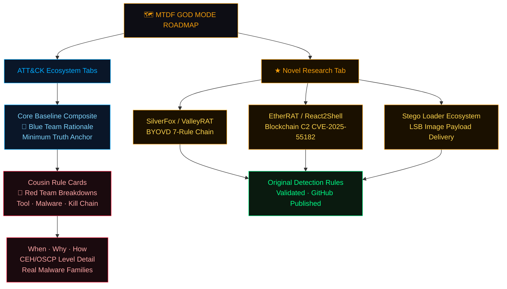

<div align="center">

```
███╗   ███╗██╗███╗   ██╗██╗███╗   ███╗██╗   ██╗███╗   ███╗    ████████╗██████╗ ██╗   ██╗████████╗██╗  ██╗
████╗ ████║██║████╗  ██║██║████╗ ████║██║   ██║████╗ ████║    ╚══██╔══╝██╔══██╗██║   ██║╚══██╔══╝██║  ██║
██╔████╔██║██║██╔██╗ ██║██║██╔████╔██║██║   ██║██╔████╔██║       ██║   ██████╔╝██║   ██║   ██║   ███████║
██║╚██╔╝██║██║██║╚██╗██║██║██║╚██╔╝██║██║   ██║██║╚██╔╝██║       ██║   ██╔══██╗██║   ██║   ██║   ██╔══██║
██║ ╚═╝ ██║██║██║ ╚████║██║██║ ╚═╝ ██║╚██████╔╝██║ ╚═╝ ██║       ██║   ██║  ██║╚██████╔╝   ██║   ██║  ██║
╚═╝     ╚═╝╚═╝╚═╝  ╚═══╝╚═╝╚═╝     ╚═╝ ╚═════╝ ╚═╝     ╚═╝       ╚═╝   ╚═╝  ╚═╝ ╚═════╝    ╚═╝   ╚═╝  ╚═╝
```

### Detection Framework — ADX-Validated Composite Rules

**Ala Dabat** · Senior Detection Engineer · Threat Hunter · Purple Team

[](https://github.com/azdabat/Minimum-Truth-Detection-Framework-ADX-Validated-Composite-Rules/tree/main/ADX-Docker-Tests)
[](https://azdabat.github.io/Minimum-Truth-Detection-Framework-ADX-Validated-Composite-Rules/MITRE-MATRIX.html)
[](https://github.com/azdabat/Minimum-Truth-Detection-Framework-ADX-Validated-Composite-Rules)
[](https://github.com/azdabat/Minimum-Truth-Detection-Framework-ADX-Validated-Composite-Rules)
[](https://github.com/azdabat/Minimum-Truth-Detection-Framework-ADX-Validated-Composite-Rules/tree/main/Threat%20Hunting%20And%20R%26D%20Docs)
[](https://github.com/azdabat)

</div>

---

## The Minimum Truth Doctrine

> **Start with the minimum truth required for the attack to exist.**  
> Everything else is reinforcement — not dependency.
>
> If the baseline truth is not met, the attack **is not real**.

```
Minimum Truth  →  Reinforcement  →  Scoring  →  Hunter Directive
```

### 1. Reductive Baseline (Truth First)

Every attack technique has a **minimum condition that must be true**.

If that condition is not met, the detection should not exist.

**Examples:**
- LSASS credential theft → *LSASS must be accessed*
- Kerberoasting → *Service tickets must be requested using weak encryption*
- OAuth abuse → *A cloud app must request high-risk scopes*

This prevents speculative or assumption-driven hunting.

### 2. Composite L2 / L2.5 Hunts (Default)

Most attacks do **not** require full behavioural chains.

Instead, this repository focuses on **Composite Hunts** that:
- Group **related high-signal indicators**
- Prefer **single telemetry sources** where possible
- Use minimal joins only when unavoidable

This is where **most effective threat hunting lives**.

### 3. Reinforcement (Confidence, Not Dependency)

Once baseline truth is met, confidence is increased using:
- parent / child execution context
- suspicious paths or arguments
- network proximity
- rarity / prevalence

Reinforcement:
- improves fidelity
- reduces noise
- **never defines the attack**

### 4. Behavioural Chains (Used Sparingly)

Behavioural correlation is used **only when the attack cannot exist without it**.

**Example:** DLL sideloading  
A DLL drop alone is benign.  
A DLL load alone is benign.  
The attack is only true when **both occur together**.

### The Principles

**Minimum Truth is necessary — but never sufficient.**  
So we never alert on truth alone. Truth is only the starting point.

> Substrate-first truth observes *where* execution occurred.  
> Intent-first truth observes *what* was done with it.  
> Both are valid. The engineer chooses the tier intentionally.

> **Rarity decides how fast we respond — not whether we respond.**

> **Correlation is not sophistication. Correlation is dependency.**

> **The detection rule is the sensor.**  
> **The incident is the narrative.**

```
Truth Anchor  = Sensor
Reinforcement = Evidence
Cousins       = Adjacent sensors
Incident      = Story stitching

Truth defines the rule. Reinforcement strengthens it.
```

```
Minimum Truth defines the attack.
Reinforcement increases confidence.
Prevalence scales triage.
```

> **The Golden Rule: If I cannot explain the hunt in 60 seconds, it is too complex.**  
> Composite engineering is clarity, not bloat.

📄 **Full framework:** [Minimum Truth Detection Framework](https://github.com/azdabat/Minimum-Truth-Detection-Framework-ADX-Validated-Composite-Rules)

---

## Flagship Rule — WMI Fileless Execution (T1546.003)

This rule anchors on the non-negotiable substrate:

```text
scrcons.exe loads a script engine DLL
```

This is extremely rare in normal enterprise environments.

```kql
// Minimum Truth — WMI Fileless Execution (T1546.003)
DeviceImageLoadEvents
| where InitiatingProcessFileName =~ "scrcons.exe"
| where FileName in~ ("vbscript.dll", "jscript.dll", "scrobj.dll")
```

**ADX-Docker validation run (lab telemetry):**


📄 [Full rule](https://github.com/azdabat/Minimum-Truth-Detection-Framework-ADX-Validated-Composite-Rules/blob/main/WMI_ECOSYSTEM_VALIDATION/WMI_Fileless_Consumer_Execution_Scrcons_Substrate.KQL) · [WMI ecosystem & cousin rules](https://github.com/azdabat/Minimum-Truth-Detection-Framework-ADX-Validated-Composite-Rules/tree/main/WMI_ECOSYSTEM_VALIDATION) · [All ADX test receipts](https://github.com/azdabat/Minimum-Truth-Detection-Framework-ADX-Validated-Composite-Rules/tree/main/ADX-Docker-Tests)

---

## How This Work Is Built

- The detection logic and the doctrine are mine. I use an AI Copilot to scaffold rules; I review every rule, and a rule only counts as validated once it has ADX receipts.
- All telemetry here comes from my own lab (ADX-Docker, Empire, Atomic Red Team) or public datasets — never from employer or client environments.

---

## R&D Publications & Purple Team Playbooks

> **Full research library:** [`Threat Hunting And R&D Docs /`](https://github.com/azdabat/Minimum-Truth-Detection-Framework-ADX-Validated-Composite-Rules/tree/main/Threat%20Hunting%20And%20R%26D%20Docs)

### 01 · Advanced Defense Evasion & C2 Detection Pack
**AMSI Bypass · LOLBin Abuse · C2 Beaconing · Defense Evasion Chains**  
Covers AMSI bypass patterns, LOLBin-hosted C2, and the behavioural composites that catch them when string-matching fails.  
**MITRE:** `T1562.001` · `T1059` · `T1218` · `T1071.001` · `T1027`  
📄 [Read](https://github.com/azdabat/Minimum-Truth-Detection-Framework-ADX-Validated-Composite-Rules/blob/main/Threat%20Hunting%20And%20R%26D%20Docs/Advanced%20Defense%20Evasion%20%26%20C2%20Detection%20Pack.md)

### 02 · Scheduled Task Persistence Ecosystem
**CLI Creation · Silent TaskCache · Lateral Execution via Scheduled Tasks**  
Full ecosystem coverage from `schtasks.exe /create` through silent TaskCache registry artefacts.  
**MITRE:** `T1053.005` · `T1021.002` · `T1543` · `T1078`  
📄 [Read](https://github.com/azdabat/Minimum-Truth-Detection-Framework-ADX-Validated-Composite-Rules/blob/main/Threat%20Hunting%20And%20R%26D%20Docs/ScheduledTask_Persistence_Ecosystem.md)

### 03 · SILVERFOX / VALLEYRAT — BYOVD Ecosystem
**Bring Your Own Vulnerable Driver · Kernel-Level Evasion · APT Tooling**  
Deep-dive into the SILVERFOX and VALLEYRAT threat clusters and their use of Bring Your Own Vulnerable Driver (BYOVD) techniques to disable EDR at the kernel level.  
**MITRE:** `T1068` · `T1562.001` · `T1014` · `T1055` · `T1036`  
📄 [Read](https://github.com/azdabat/Minimum-Truth-Detection-Framework-ADX-Validated-Composite-Rules/blob/main/Threat%20Hunting%20And%20R%26D%20Docs/SILVERFOX_VALLEYRAT_BYOVD_Ecosystem.md)

### 04 · Ghost Pixels — Purple Team Steganography Playbook
**Image / Audio / PDF Stego · DNS Tunnel · Polyglot Files · C2 via CDN**  
Full-spectrum purple team playbook for steganography-based attack chains.  
**MITRE:** `T1027.003` · `T1071.001` · `T1071.004` · `T1095` · `T1140` · `T1218`  
📄 [Read](https://github.com/azdabat/Minimum-Truth-Detection-Framework-ADX-Validated-Composite-Rules/blob/main/Threat%20Hunting%20And%20R%26D%20Docs/ghost_pixels_purple_team_stego_playbook.md)

### 05 · ATT&CK Substrate Adjacency — Detection Coverage Beyond Technique Taxonomy
This document introduces **Substrate Adjacency** — the missing horizontal layer that sits on top of ATT&CK.  
📄 [Read](https://github.com/azdabat/Minimum-Truth-Detection-Framework-ADX-Validated-Composite-Rules/blob/main/ATT%26CK_Substrate_Adjacency.md)

### 06 · SilverFox / ValleyRAT — BYOVD vs Polymorphic Malware: Why Signatures Fail and Behaviour Wins
SilverFox and ValleyRAT represent a category of Chinese-nexus threat actor tradecraft that weaponises Windows driver trust to achieve kernel-level EDR blinding before any overtly malicious activity occurs.  
📄 [Read](https://github.com/azdabat/Novel-Tradecraft-Research-Emerging-Attack-Ecosystems/blob/main/SilverFox-BYOVD-Vs-Polymorphic-Malware-README.md)

### 07 · Adversary-Informed Threat Hunting — MDE & Sentinel Playbook
Most SOC teams hunt reactively — an alert fires, an analyst investigates. This playbook inverts that model.  
📄 [Read](https://github.com/azdabat/Minimum-Truth-Detection-Framework-ADX-Validated-Composite-Rules/blob/main/Threat%20Hunting%20And%20R%26D%20Docs/Threat-Hunting-Playbook.md) · [Threat Hunting Roadmap](https://azdabat.github.io/Threat-Hunting/roadmap/)

### 08 · Threat Hunting vs Detection Engineering — When to Hunt, When to Engineer, and Why the Difference Matters
Threat hunting and detection engineering are two fundamentally different disciplines that feed each other — and conflating them produces rules that are too broad for production and hunts too narrow to find anything new.  
📄 [Read](https://github.com/azdabat/Minimum-Truth-Detection-Framework-ADX-Validated-Composite-Rules/blob/main/Threat-Hunting-Vs-Detection-Engineering.md)

### 09 · AI-Accelerated Attack Surface Evolution — Composite Behavioural Detection in the Age of Polymorphic Malware
Signature-based detection is built on a premise AI has now structurally invalidated: that knowing what an attack *looks like* is sufficient to detect it.  
📄 [Read](https://github.com/azdabat/-AI-LLM-Autonomous-Systems/blob/main/AI-Accelerated%20Attack%20Surface%20Evolution.md)

### 10 · Advanced Threat Hunting — Senior Analyst Reference: Detection, Investigation & Incident Response
Advanced threat hunting operates at the intersection of telemetry analysis, adversary tradecraft, and detection engineering.  
📄 [Read](https://github.com/azdabat/Threat-Hunting/blob/main/Advanced%20Threat%20Hunting.md) · [Repo](https://github.com/azdabat/Threat-Hunting/tree/main)

### 11 · MTDF AI Copilot — Agentic Detection Engineering Pipeline: Architecture, Implementation & Operational Guide (v4)
The pipeline runs **AnythingLLM desktop** as the orchestration and RAG layer, backed by **Claude Sonnet 4.6 via the Anthropic API** at temperature=0 for deterministic output, with a nine-section v4 system prompt that enforces the complete MTDF doctrine as non-negotiable operating constraints.  
📄 [Read](https://github.com/azdabat/-AI-LLM-Autonomous-Systems/blob/main/MTDF%20AI%20Copilot%20%E2%80%94%20R%26D%20Master%20Documen.md)

### 12 · MTDF AI Copilot — Agentic Detection Engineering Pipeline: Architecture, Implementation & Operational Guide (v5)
Five questions are asked before every rule generation — scope, noise domain, fidelity requirement, telemetry availability, and operational context — each with a clear explanation of why it is being asked and what the answer means architecturally.  
📄 [Read](https://github.com/azdabat/-AI-LLM-Autonomous-Systems/blob/main/Router%20Rule%20-%20R%26D%20Master%20Document.md)

### 13 · Router Rules — How Sensors Become Incidents: The Attack Narrative Pipeline
This document is the complete reference for the Router Rule doctrine within the Minimum Truth Detection Framework.  
📄 [Router Rule Framework repo](https://github.com/azdabat/Router-Rule-Franework)

### 14 · MTDF AI Copilot — Agentic Detection Engineering Pipeline: The Complete Empire LLM Framework (v6)
The Engineering Workspace (Empire_LLM_Framework) runs the MTDF v6 system prompt — 815 lines covering seven detection architectures, six skeleton templates, ten non-negotiable engineering rules, the cousin technique doctrine, the Empire C2 telemetry context, full MDE and Sentinel schema reference, and the complete three-layer classification protocol.  
📄 [Read](https://github.com/azdabat/-AI-LLM-Autonomous-Systems/blob/main/MTDF%20AI%20Copilot%20%E2%80%94%20R%26D%20Master%20Document%20v2.md)

### 15 · Node.js Child Process Abuse — Tradecraft Study, Attack Analysis & Full MTDF Detection Architecture
This study examines how adversaries identify Node.js backends, exploit them through five distinct code execution vectors, and weaponise the `child_process` module to deliver reverse shells and remote access payloads across both Linux and Windows environments.  
📄 [Read](https://github.com/azdabat/Novel-Tradecraft-Research-Emerging-Attack-Ecosystems/blob/main/Node.js%20Child%20Process%20Abuse.md)

---

## 🗺️ God Mode Composite Roadmap

**[→ OPEN INTERACTIVE ROADMAP](https://azdabat.github.io/Minimum-Truth-Detection-Framework-ADX-Validated-Composite-Rules/index.html)**

The God Mode Composite Roadmap is the capstone artefact of the Minimum Truth Detection Framework — a complete, interactive reference mapping every major ATT&CK tactic to its **core baseline composite rule**, its **cousin technique ecosystem**, and a **full red team breakdown** of how each attack is deployed in the real world.

This is not a vendor rule pack or an ATT&CK navigator heatmap. It is a living R&D document that answers three questions for every detection:

- **Why is this composite shaped this way?** — the blue team rationale, minimum truth anchor, and reinforcement signal logic
- **How does an attacker actually deploy this technique?** — CEH/OSCP level methodology, tool names, real malware families, full kill chain position
- **What are the cousin attack surfaces?** — adjacent techniques that share substrate or intent primitives, each with their own composite and red team context

### Coverage

| Tactic | Core Composites | Cousin Rules |
|---|---|---|
| Execution | PowerShell, WMI, LOLBins | AMSI bypass, download cradles, mshta, rundll32, regsvr32 |
| Persistence | Registry run keys, WMI subscriptions | Scheduled tasks, DLL sideloading |
| Privilege Escalation | Process injection, token theft | UAC bypass, fodhelper chain |
| Defense Evasion | BYOVD, EDR kill chain | Byte-flip mutation, callback deregistration |
| Credential Access | LSASS memory dump | DCSync, Kerberoasting |
| Discovery | Velocity sweep composite | BloodHound/LDAP enumeration |
| Lateral Movement | Pass-the-Hash/Ticket | WMI remote execution, Impacket chains |
| Collection | Archive staging | Pre-exfil compression patterns |
| C2 | HTTPS beaconing | DNS tunnelling, blockchain C2 |
| Exfiltration | Volume anomaly | Cloud storage exfil (rclone, MEGAcmd) |
| Impact | Ransomware in-progress | VSS deletion anchor, encryption velocity |
| ★ Novel Research | SilverFox/ValleyRAT BYOVD | EtherRAT blockchain C2, Steganographic loaders |

### Novel Research Tab

The roadmap includes a dedicated tab for original MTDF threat research — families with no vendor rule coverage, fully documented from kill chain through detection engineering:

- **SilverFox / ValleyRAT** — 7-rule, 3-tier detection covering the complete BYOVD EDR kill chain including byte-flip hash mutation defence
- **EtherRAT / React2Shell (CVE-2025-55182)** — Blockchain C2 detection via Ethereum RPC polling; the C2 channel is the public blockchain itself
- **Steganographic Loader Ecosystem** — Multi-phase detection covering LSB image inspection, .NET in-memory execution, and full IR SOP



[](https://azdabat.github.io/Minimum-Truth-Detection-Framework-ADX-Validated-Composite-Rules/MITRE-MATRIX.html)

---

<div align="center">

**GitHub:** [github.com/azdabat](https://github.com/azdabat) &nbsp;|&nbsp; **Email:** azdabat193@gmail.com &nbsp;|&nbsp; **Location:** United Kingdom

[](https://github.com/azdabat)
[](mailto:azdabat193@gmail.com)

<br>

*"Translating adversary behaviour into measurable defensive depth."*

</div>
